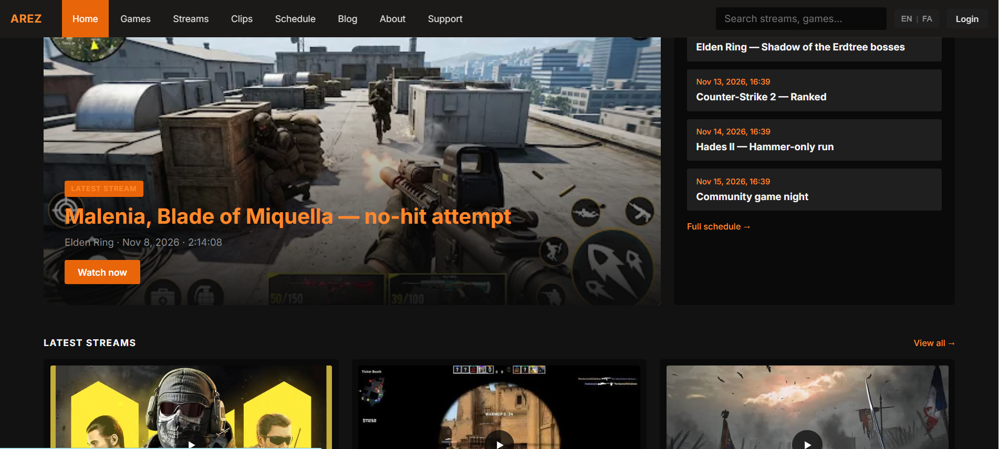

# Gamepov 🎮🟧⬛

**Gamepov** یک قالب وب‌سایت شخصی برای یک گیمر/استریمر است. هر استریم، کلیپ و هایلایت در یک آرشیو قابل جستجو منتشر می‌شود و **برای هر ویدیو یک صفحه‌ی HTML جداگانه با SEO کامل** ساخته می‌شود تا در گوگل دیده شود.
هر گیمر یک کپی شخصی از این پروژه می‌گیرد (نام، لینک‌ها، رنگ، زبان و محتوای خودش).

*English:* Gamepov is a template for a personal gamer/streamer website: stream archive, games library, clips, schedule, blog, stats, comments, admin panel — plain HTML/CSS/JS, Supabase backend, GitHub Pages hosting, and a build script that generates static, SEO-ready pages (JSON-LD `VideoObject`, sitemap with video entries, Open Graph).

---

## ⚡ شروع سریع (دیدن سایت در مرورگر)

**ساده‌ترین راه (بدون نصب هیچ چیز):** zip را Extract کن و فایل **`OPEN-ME.html`** (یا `preview/index.html`) را دابل‌کلیک کن. سایت کامل با همه‌ی صفحه‌ها، جستجو و تغییر زبان فارسی/انگلیسی باز می‌شود. (فونت‌ها داخل پروژه‌اند؛ اینترنت لازم نیست.)
> نکته: در این حالت فقط بخش‌های ظاهری کار می‌کنند. ورود، کامنت، آپلود و پنل ادمین به Supabase و اجرای روی سرور/GitHub Pages نیاز دارند.

**اجرا مثل سایت واقعی (با سرور محلی):**

- **ویندوز:** دابل‌کلیک روی `start.bat`
- **مک/لینوکس:** در ترمینال `./start.sh`
- یا دستی: `npm run build` و بعد `npm run serve` و باز کردن http://localhost:8080

نیازمندی: [Node.js](https://nodejs.org) (نسخه‌ی LTS). اگر Node نداری ولی Python داری، همان فایل‌ها پوشه‌ی آماده‌ی `dist/` را نشان می‌دهند.
اولین بار سایت با **محتوای نمونه** (گیمر ساختگی «Nova Strike») باز می‌شود؛ بعد از اتصال Supabase محتوای خودت می‌آید.

---

## امکانات

| بخش | توضیح |
|---|---|
| **صفحه‌ی اصلی** | بنر زنده (Live)، آخرین استریم، برنامه‌ی پخش، بازی‌ها، کلیپ‌ها، معرفی |
| **آرشیو استریم‌ها** | جستجو، فیلتر بر اساس بازی، مرتب‌سازی، «نمایش بیشتر» |
| **صفحه‌ی ویدیو** | پلیر (YouTube / Twitch / فایل آپلودشده)، توضیحات، قبلی/بعدی، ویدیوهای مرتبط، **کامنت** |
| **کتابخانه‌ی بازی‌ها** | صفحه‌ی جدا برای هر بازی (مثل صفحه‌ی فروشگاه Steam) با آمار و آرشیو همان بازی |
| **کلیپ‌ها و هایلایت‌ها** | با فیلتر نوع و بازی |
| **برنامه‌ی پخش** | زمان‌ها به وقت محلی بیننده، شمارش معکوس، «افزودن به تقویم» (.ics) |
| **درباره‌ی من و ستاپ** | بیو، لینک‌های اجتماعی، لیست سخت‌افزار/نرم‌افزار |
| **وبلاگ و اخبار** | نوشته‌ها با Markdown ساده |
| **آمار و دستاوردها** | ساعت استریم، پراستریم‌ترین بازی‌ها، نمودار ماهانه، دستاوردها |
| **تماس و اسپانسر** | فرم تماس (ذخیره در Supabase)، لیست اسپانسرها |
| **حمایت** | فقط لینک به سرویس‌های حمایت (Ko-fi، Patreon، …) |
| **حساب بیننده** | ثبت‌نام/ورود برای کامنت‌گذاشتن |
| **پنل ادمین** | ورود امن؛ مدیریت استریم‌ها (آپلود مستقیم ویدیو با نوار پیشرفت)، بازی‌ها، برنامه، وبلاگ، دستاوردها، اسپانسرها، کامنت‌ها، پیام‌ها، تنظیمات، و دکمه‌ی **Go live** |
| **دو زبانه** | انگلیسی + فارسی (راست‌به‌چین) با دکمه‌ی EN \| FA؛ پیش‌فرض در `site.config.json` |
| **SEO** | `<title>/description/canonical`، Open Graph، JSON-LD (`VideoObject`, `VideoGame`, `BlogPosting`, `BreadcrumbList`, `WebSite`, `Person`)، `sitemap.xml` (با تگ ویدیو)، `robots.txt`، `feed.xml` |

## ساختار پروژه

```
gamepov/
├─ site.config.json        ← تنظیمات هر گیمر (نام، لینک‌ها، رنگ، زبان، Supabase)
├─ data/demo.json          ← محتوای نمونه (وقتی Supabase وصل نیست)
├─ supabase/schema.sql     ← جدول‌ها، امنیت (RLS) و Storage — یک‌بار اجرا شود
├─ scripts/
│  ├─ build.js             ← تولید صفحات استاتیک در dist/
│  ├─ serve.js             ← سرور محلی برای دیدن dist/
│  └─ lib/                 ← قالب‌های HTML، بارگذاری داده
├─ src/
│  ├─ css/style.css        ← تم نارنجی/مشکی
│  └─ js/                  ← app.js، صفحه‌ها (pages/)، پنل ادمین (pages/admin.js)، کتابخانه‌ها
├─ tests/                  ← تست واحد + تست مرورگری (Playwright) + Supabase ساختگی
├─ .github/workflows/deploy.yml   ← بیلد و انتشار خودکار روی GitHub Pages
└─ docs/figma.md           ← لینک طراحی فیگما
```

## راه‌اندازی (برای یک گیمر)

### ۱) اجرای محلی با داده‌ی نمونه
```bash
npm run build      # ساخت dist/ (به Node 18+ نیاز دارد؛ بدون هیچ پکیج اضافه)
npm run serve      # http://localhost:8080
```

### ۲) ساخت بک‌اند در Supabase
1. در [supabase.com](https://supabase.com) یک پروژه بساز.
2. **SQL Editor** → فایل `supabase/schema.sql` را کامل اجرا کن.
3. **Authentication → Providers → Email**: اگر نمی‌خواهی بیننده‌ها ایمیل تأیید بزنند، گزینه‌ی *Confirm email* را خاموش کن (روشن هم کار می‌کند؛ سایت پیام «ایمیلت را بررسی کن» نشان می‌دهد).
4. **Project Settings → API**: مقدار `Project URL` و `anon public key` را بردار.
5. آپلود فایل‌های حجیم: پلن رایگان فقط تا ۵۰MB برای هر فایل اجازه می‌دهد. برای استریم‌های طولانی پلن Pro بگیر و در **Storage → Settings** سقف حجم فایل را بالا ببر. (راه ارزان‌تر: ویدیو را در YouTube/Twitch آپلود کن و لینکش را در پنل بگذار.)

### ۳) تنظیمات سایت
فایل `site.config.json` را ویرایش کن:
- `siteUrl` → آدرس نهایی سایت (مثلاً `https://yourname.github.io/gamepov`)
- `supabase.url` و `supabase.anonKey` (کلید anon عمومی است و طبق طراحی Supabase امن است؛ دسترسی‌ها با RLS کنترل می‌شود)
- `profile` و `links` و `support` و `setup` → نام، تگ‌لاین، بیو، لینک‌ها
- `theme` → رنگ‌ها، `defaultLang` → `"en"` یا `"fa"`
- اختیاری: `githubRepo` (برای دکمه‌ی انتشار در پنل ادمین) و `customDomain`

> بعداً همه‌ی مقادیر پروفایل/لینک‌ها/حمایت/ستاپ را می‌توان از **پنل ادمین → Settings** هم عوض کرد؛ آنچه آنجا پر شود روی فایل کانفیگ اولویت دارد.

### ۳.۵) نکته‌ی امنیتی
به جای نوشتن کلیدها در فایل، می‌توانی در GitHub → *Settings → Secrets and variables → Actions* مقدارهای `SUPABASE_URL` و `SUPABASE_ANON_KEY` را بگذاری؛ workflow آن‌ها را هنگام بیلد استفاده می‌کند.

### ۴) انتشار روی GitHub Pages
1. پروژه را در یک مخزن GitHub بگذار (شاخه‌ی `main`).
2. **Settings → Pages → Source: GitHub Actions**.
3. با هر push و همچنین **هر ۳۰ دقیقه** سایت دوباره ساخته می‌شود. برای انتشار فوری: **Actions → Build & Deploy → Run workflow**.

### ۵) اولین ورود
1. به `/account/` برو و حساب بساز — **اولین حساب خودکار ادمین می‌شود**.
2. به `/admin/` برو، بازی‌ها و استریم‌ها را اضافه کن.
3. در [Google Search Console](https://search.google.com/search-console) سایت را ثبت کن و `…/sitemap.xml` را ارسال کن تا ویدیوها سریع‌تر ایندکس شوند.

## نحوه‌ی کار انتشار (مهم)
محتوا در Supabase ذخیره می‌شود، اما صفحه‌های عمومی **در زمان بیلد** به HTML استاتیک تبدیل می‌شوند (برای SEO). پس بعد از افزودن ویدیو، صفحه‌ی آن بعد از بیلد بعدی (حداکثر ۳۰ دقیقه یا با Run workflow) ظاهر می‌شود. این موارد **بدون بیلد و فوری** هستند: وضعیت Live، کامنت‌ها، فرم تماس، ورود/ثبت‌نام.

## افزودن ویدیو
- **YouTube / Twitch:** لینک یا ID را بچسبان؛ تامبنیل YouTube خودکار گرفته می‌شود. (برای Twitch، دامنه‌ی سایت باید در `siteUrl` درست باشد چون Twitch پارامتر `parent` می‌خواهد.)
- **آپلود مستقیم:** در فرم ویدیو، منبع را روی «Upload a video file» بگذار، فایل را انتخاب کن؛ مدت ویدیو خودکار پر می‌شود.
- در توضیحات می‌توانی فصل‌بندی بنویسی (مثلاً `12:40 Boss fight`)؛ برای گوگل مفید است.

## تست
```bash
npm test            # unit (۱۷ تست) + e2e با Chromium واقعی (۱۹ تست)
node tests/unit.test.js
node tests/e2e.test.cjs     # به Playwright نیاز دارد: npm i -D playwright
npm run mock        # Supabase ساختگی محلی روی پورت 54321 برای آزمایش بدون حساب
```
تست‌ها بررسی می‌کنند: همه‌ی لینک‌ها و فایل‌ها، توازن تگ‌های HTML، JSON-LD، sitemap، ترجمه‌ها (کلیدهای en/fa یکسان)، فیلترها، جستجو، تغییر زبان و RTL، ثبت‌نام/کامنت/XSS، فرم تماس، تمام عملیات پنل ادمین (CRUD، آپلود، تنظیمات، Live)، دسترسی غیرادمین، و حلقه‌ی کامل «افزودن در ادمین → بیلد → صفحه‌ی جدید».

## طراحی
طراحی صفحات در فیگما (سبک Steam Redesign، تم نارنجی/مشکی): لینک را در `docs/figma.md` ببین.

## محدودیت‌های شناخته‌شده
- محتوای ویدیوها/وبلاگ ترجمه نمی‌شود (فقط رابط کاربری دوزبانه است).
- تعداد بازدید/آمار تماشا ندارد (سایت استاتیک است؛ می‌توان بعداً Plausible/Umami اضافه کرد).
- پلن رایگان Supabase بعد از ۷ روز بی‌فعالیتی پروژه را متوقف می‌کند؛ cron هر ۳۰ دقیقه‌ی workflow آن را فعال نگه می‌دارد.
- حمایت مالی فقط لینک است؛ پرداخت داخلی ندارد.

## لایسنس
MIT — آزادانه استفاده و تغییر بده.

---
## Font licenses
Inter and Vazirmatn are bundled under the SIL Open Font License (see `src/fonts/OFL-*.txt`).
